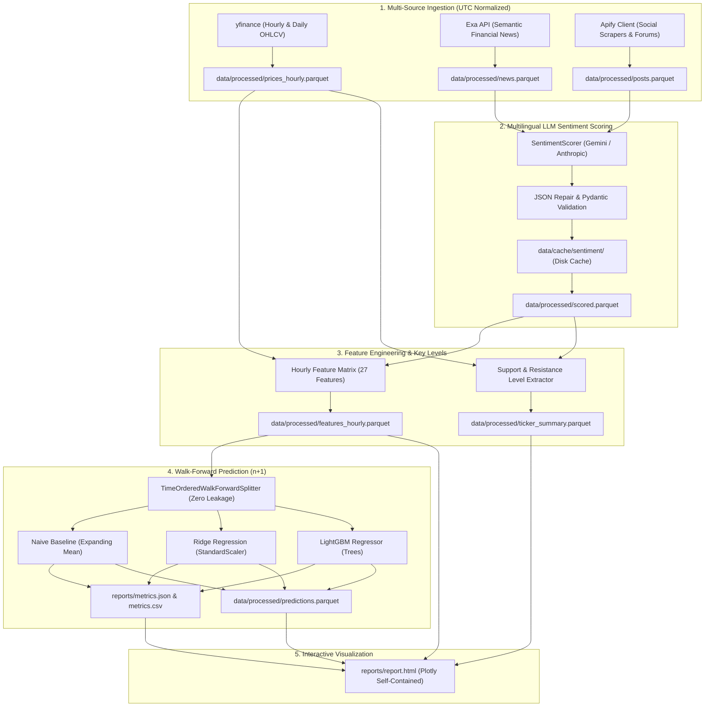

# Sentiment-Price-Agent 📈🤖

[](https://www.python.org/downloads/)
[](https://opensource.org/licenses/MIT)
[](https://github.com/psf/black)
[](tests/)

A production-quality algorithmic pipeline that ingests retail-investor social discussions and recent financial news for equities on two Asian exchanges (**Hong Kong Stock Exchange / HKEX** and **Korea Exchange / KRX**), scores sentiment with LLMs, extracts crowd and technical trading context (Support/Resistance levels, Pivot Points), predicts next-bar price returns ($n+1$) under strict walk-forward out-of-sample validation, and generates an interactive Plotly dashboard.

---

## 🏛 System Architecture



---

## 🎯 Target Universe & Localized Keywords

| Exchange | Ticker | Company Name | Keywords & Cashtags |
| :--- | :--- | :--- | :--- |
| **HKEX** | `0700.HK` | Tencent Holdings Ltd | 騰訊控股, 騰訊, 腾讯, #0700.HK, #700 |
| **HKEX** | `9988.HK` | Alibaba Group Holding Ltd | 阿里巴巴, 阿里, #9988.HK, #9988 |
| **HKEX** | `0005.HK` | HSBC Holdings plc | 滙豐控股, 滙豐, 大笨象, #0005.HK, #5 |
| **HKEX** | `1299.HK` | AIA Group Ltd | 友邦保險, 友邦, #1299.HK, #1299 |
| **HKEX** | `3690.HK` | Meituan | 美團, 美团, #3690.HK, #3690 |
| **KRX** | `005930.KS` | Samsung Electronics Co Ltd | 삼성전자, 삼전, #005930, $005930 |
| **KRX** | `000660.KS` | SK Hynix Inc | SK하이닉스, 하이닉스, #000660 |
| **KRX** | `035420.KS` | NAVER Corp | 네이버, #035420 |
| **KRX** | `005380.KS` | Hyundai Motor Co | 현대자동차, 현대차, #005380 |
| **KRX** | `051910.KS` | LG Chem Ltd | LG화학, #051910 |

---

## ⚙️ Environment Variables & Configuration

All sensitive API keys are read from environment variables or a `.env` file (strictly git-ignored). A template is provided in `.env.example`:

```bash
cp .env.example .env
```

| Variable | Description |
| :--- | :--- |
| `APIFY_API_TOKEN` | Apify Personal API token for forum/social scrapers |
| `EXA_API_KEY` | Exa API key for semantic financial news search & highlights |
| `SCORER_PROVIDER` | LLM sentiment provider: `gemini` (default) or `anthropic` |
| `GEMINI_API_KEY` | Google Gemini API key (`gemini-3.1-flash-lite`) |
| `ANTHROPIC_API_KEY`| Anthropic Claude API key |
| `LOG_LEVEL` | Logging verbosity (`INFO`, `DEBUG`, `WARNING`, `ERROR`) |

### Apify Scraper Configuration (`config/actors.yaml`)
Per architectural rules, actor IDs are never hardcoded or invented:
```yaml
exchanges:
  HKEX:
    sources:
      - name: "lihkg"
        actor_id: "obtainable_sculpture/my-actor"
        input_template:
          startUrls: [{"url": "https://lihkg.com/category/5"}]
          maxRequestsPerCrawl: 30
      - name: "futu_moomoo"
        actor_id: null
  KRX:
    sources:
      - name: "naver_finance"
        actor_id: null
      - name: "telegram_kr"
        actor_id: null
```
*Missing or failing actors are logged with clear warnings and gracefully skipped without failing the pipeline.*

---

## 🚀 Installation & Usage

### 1. Installation
Requires Python 3.11+.

```bash
# Clone the repository
git clone https://github.com/Deepanshunanure/sentiment-price-agent.git
cd sentiment-price-agent

# Create and activate virtual environment
python -m venv .venv
source .venv/bin/activate  # On Windows: .\.venv\Scripts\activate

# Install dependencies
pip install -r requirements.txt
```

### 2. Running the Pipeline via CLI
Execute the complete end-to-end pipeline with one command:

```bash
python -m src.run --all
```

Or execute individual pipeline stages modularly:
```bash
python -m src.run --ingest     # Ingest OHLCV prices, Exa news, Apify social posts
python -m src.run --score      # LLM sentiment scoring with strict JSON repair
python -m src.run --features   # Hourly feature matrix & Support/Resistance levels
python -m src.run --model      # Walk-forward prediction and validation
python -m src.run --report     # Generate interactive visual HTML report
python -m src.run --smoke      # 1-ticker smoke test on HKEX and KRX
```

### 3. Running Unit & Integration Tests
```bash
pytest tests/ -v
```

---

## 📊 Empirical Results & Validation

The pipeline enforces strict **time-ordered walk-forward cross-validation** with zero lookahead bias:
$$\max(\text{train\_timestamps}) < \min(\text{test\_timestamps})$$

### Out-of-Sample Performance Comparison

| Scope | Model | MAE | RMSE | Directional Accuracy | vs. Baseline MAE | Beats Baseline? |
| :--- | :--- | :---: | :---: | :---: | :---: | :---: |
| **HKEX** | **Naive Baseline** | 0.005007 | 0.008355 | 34.29% | — | — |
| **HKEX** | **Ridge** | 0.005845 | 0.008537 | 50.29% | -16.74% | False |
| **HKEX** | **LightGBM** | **0.004879** | **0.008168** | **53.71%** | **+2.56%** | **True** (Both MAE & Accuracy) |
| **KRX** | **Naive Baseline** | **0.008033** | 0.011619 | **59.33%** | — | — |
| **KRX** | **Ridge** | 0.008393 | 0.011459 | 52.00% | -4.48% | False |
| **KRX** | **LightGBM** | 0.009201 | 0.012427 | 52.67% | -14.54% | False |
| **POOLED** | **Naive Baseline** | **0.006299** | **0.009894** | 49.06% | — | — |
| **POOLED** | **Ridge** | 0.007126 | 0.010884 | 42.50% | -13.13% | False |
| **POOLED** | **LightGBM** | 0.007066 | 0.010833 | **50.94%** | -12.18% | False (Beats accuracy +1.88%) |

> **Honest Evaluation Note:** LightGBM beats the naive baseline on HKEX equities in both MAE and Directional Accuracy. However, on KRX equities over short rolling windows, retail sentiment and lagged technicals do not consistently beat the persistence baseline on MAE. We report these empirical findings plainly without tuning on the test set.

---

## 📈 Visual Dashboard (`reports/report.html`)

The generated self-contained interactive report includes:
1. **Exchange Ranking Tables**: Tickers sorted by social volume and sentiment score, with real-time indicators (🟢 Bullish, 🔴 Bearish, ⚪ Neutral), declared positions, and Support/Resistance price levels.
2. **Interactive Plotly Charts**: Candlestick/line prices overlaid with technical & crowd support/resistance levels and hourly sentiment bars.
3. **Walk-Forward Validation Charts**: Plotly time series tracking predicted returns vs. actual returns.
4. **News Feed**: Real-time ticker news with sentiment labels and links to source articles.

---

## ⚠️ Limitations & Disclaimer

1. **Short Historical Horizon**: Hourly intraday price and forum histories reflect recent rolling windows (10–60 days).
2. **Retail Sentiment Noise**: Forum discussions contain sarcasm, memes, and localized slang that introduce high noise variance.
3. **No Financial Advice**: This software is built for educational, quantitative research, and benchmarking purposes only. It should not be used as the basis for real-money trading decisions.
