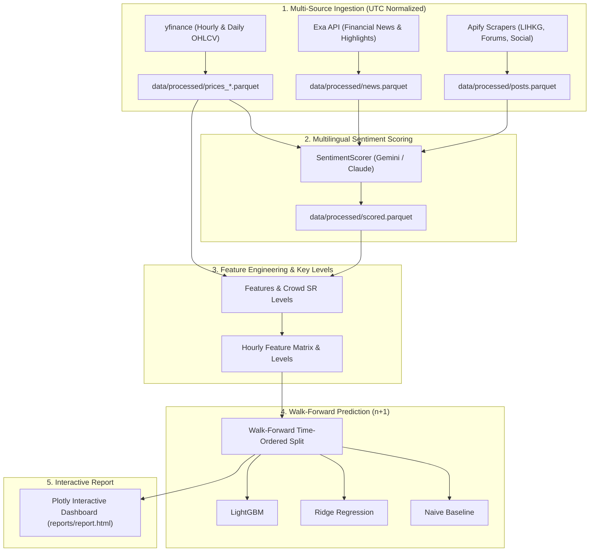

# Sentiment-Price-Agent 📈🤖

A production-grade algorithmic pipeline that ingests retail-investor social sentiment and recent news for Hong Kong (`HKEX`) and Korean (`KRX`) equities, scores multimodal sentiment with LLMs, extracts crowd and technical price levels, and evaluates predictive power for next-bar return forecasting (`n+1`).

---

## 🏛 Architecture Overview



---

## 🎯 Target Universe

| Exchange | Ticker | Company Name | Keywords & Cashtags |
| :--- | :--- | :--- | :--- |
| **HKEX** | `0700.HK` | Tencent Holdings Ltd | 騰訊控股, 騰訊, #0700.HK, #700 |
| **HKEX** | `9988.HK` | Alibaba Group Holding Ltd | 阿里巴巴, 阿里, #9988.HK |
| **HKEX** | `0005.HK` | HSBC Holdings plc | 滙豐控股, 滙豐, 大笨象, #0005.HK |
| **HKEX** | `1299.HK` | AIA Group Ltd | 友邦保險, 友邦, #1299.HK |
| **HKEX** | `3690.HK` | Meituan | 美團, #3690.HK |
| **KRX** | `005930.KS` | Samsung Electronics Co Ltd | 삼성전자, 삼전, #005930 |
| **KRX** | `000660.KS` | SK Hynix Inc | SK하이닉스, 하이닉스, #000660 |
| **KRX** | `035420.KS` | NAVER Corp | 네이버, #035420 |
| **KRX** | `005380.KS` | Hyundai Motor Co | 현대자동차, 현대차, #005380 |
| **KRX** | `051910.KS` | LG Chem Ltd | LG화학, #051910 |

---

## ⚙️ Environment Variables

Copy `.env.example` to `.env` and fill in your API tokens:

```bash
cp .env.example .env
```

| Variable | Description |
| :--- | :--- |
| `APIFY_API_TOKEN` | Apify Personal API token for social scrapers |
| `EXA_API_KEY` | Exa API key for semantic financial news search |
| `SCORER_PROVIDER` | LLM Scorer provider: `gemini` or `anthropic` |
| `GEMINI_API_KEY` | Google Gemini API key |
| `ANTHROPIC_API_KEY`| Anthropic Claude API key |
| `LOG_LEVEL` | Logging level (`DEBUG`, `INFO`, `WARNING`, `ERROR`) |

---

## 🚀 Quick Start

### 1. Installation

```bash
# Clone the repository
git clone https://github.com/Deepanshunanure/sentiment-price-agent.git
cd sentiment-price-agent

# Create virtual environment (Python 3.11+)
python -m venv .venv
source .venv/bin/activate  # On Windows: .\.venv\Scripts\activate

# Install dependencies
pip install -r requirements.txt
```

### 2. Run Stage 1 Ingestion Smoke Test

```bash
python -m src.smoke_test_stage1
```

### 3. Run Tests

```bash
pytest tests/ -v
```

---

## 🛡️ Robustness & Anti-Leakage Rules
- **Normalized UTC**: All price bars, social posts, and news articles are explicitly normalized to UTC.
- **Fail-Safe Ingestion**: Apify Actor IDs are read strictly from `config/actors.yaml`. Missing or failing actors are logged and gracefully skipped without terminating the pipeline.
- **API Caching**: All Exa queries, Apify dataset responses, and yfinance price calls are cached locally under `data/cache/` with configurable TTL to avoid burning credits.
- **Strict Walk-Forward Evaluation**: Time-ordered splits with zero lookahead bias; no random splits.

---

## ⚠️ Limitations & Disclaimer
1. **Short History**: Hourly intraday windows are limited to recent rolling periods (e.g. 10-60 days).
2. **Sentiment Noise**: Retail investor forums exhibit high noise-to-signal ratios, sarcasm, and slang.
3. **No Financial Advice**: This project is for empirical research and educational purposes only. Do not use for automated trading execution.
